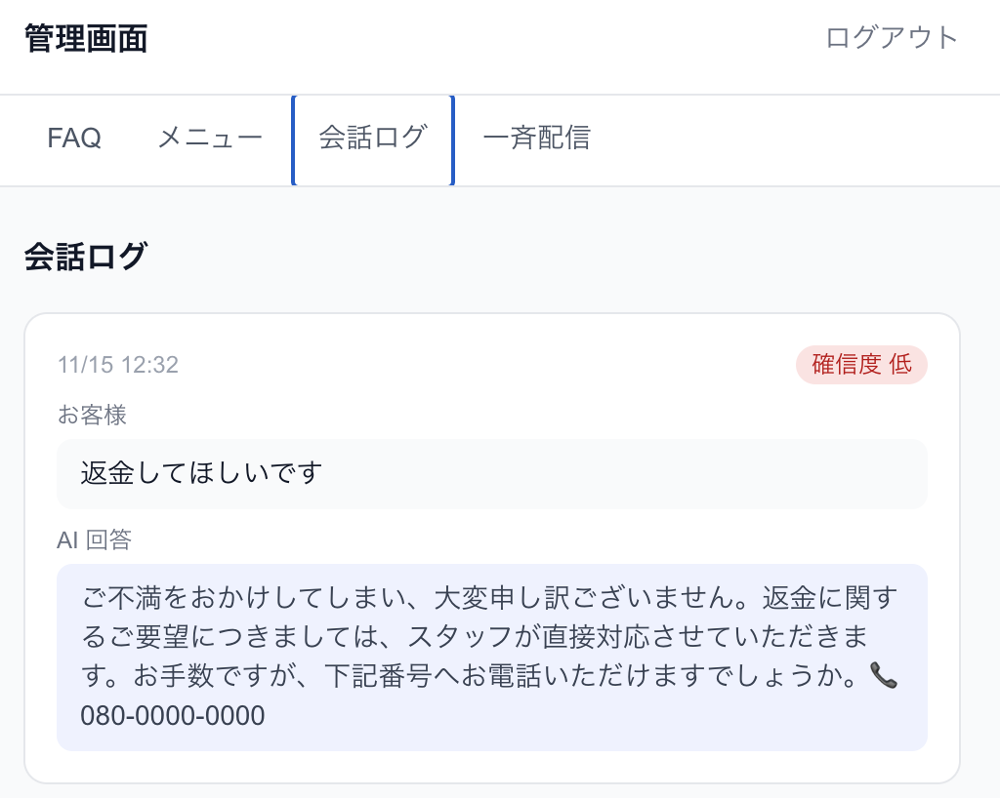
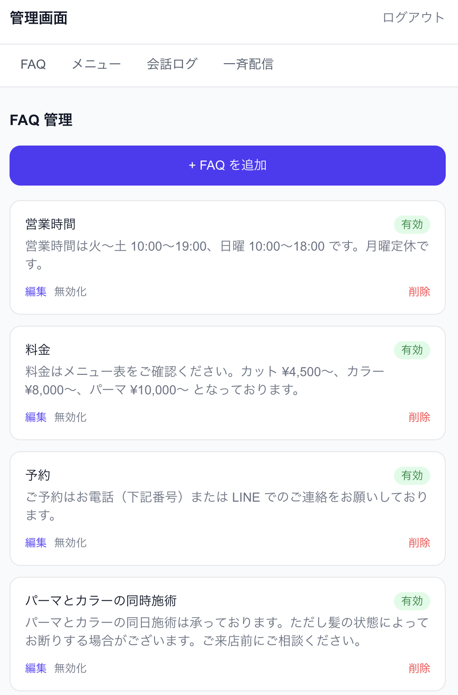
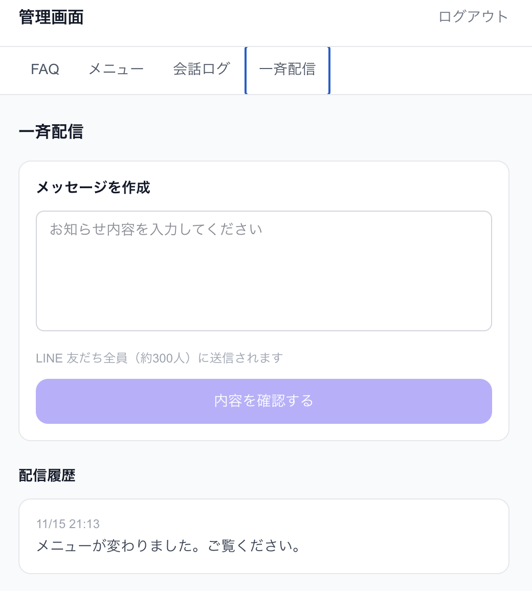

# 美容室向け LINE Bot + AI 自動応答システム

> 1 日 10〜15 件の LINE 問い合わせを Claude で自動応答し、オーナーの対応工数を削減するクライアント案件。

**公開 URL**: https://anken1.vercel.app/admin/login

---

## 画面

| 管理画面 — FAQ | 会話ログ | 一斉配信 |
|---|---|---|
|  |  |  |

---

## 機能

### LINE Bot（お客様向け）
- FAQ・メニュー情報をもとに Claude が日本語で自動返信
- **確信度判定**（高 / 中 / 低）: 答えられない質問はオーナーの LINE へエスカレーション通知
- スタンプ・画像・不正リクエストなどのエッジケースも安全にハンドリング

### 管理画面（オーナー向け・スマホ最適化）
- FAQ の追加・編集・有効化 / 無効化・削除
- メニュー・料金の管理（カテゴリごとに整理）
- 会話ログ一覧（確信度バッジ付き）
- お知らせ一斉配信（確認画面 → 送信 → 履歴）

---

## 技術スタック

| 層 | 技術 |
|---|---|
| フロント / API | Next.js 16 (App Router) + TypeScript + Tailwind CSS |
| ホスティング | Vercel |
| DB / Auth | Supabase (PostgreSQL + RLS) + Supabase Auth (マジックリンク) |
| AI | Anthropic Claude API (`claude-sonnet-4-6`) |
| LINE | LINE Messaging API v11 (`@line/bot-sdk`) |

---

## アーキテクチャ

```
LINE アプリ
  │  メッセージ送信
  ▼
POST /api/webhook  ← LINE 署名検証
  │
  ├─ Supabase から FAQ・メニューを取得
  ├─ Claude API (claude-sonnet-4-6) へ送信
  │    └─ JSON レスポンス: { answer, confidence }
  │
  ├─ LINE replyMessage ─────────────── お客様へ返信
  ├─ Supabase conversations テーブルへ記録
  └─ confidence === '低' の場合のみ
       ├─ LINE pushMessage ────────── オーナーへ通知
       └─ Supabase escalation_logs へ記録

管理画面 (/admin/*)
  │  Next.js Server Actions
  ▼
Supabase (faqs / menu_items / conversations / broadcast_logs)
```

---

## Claude への FAQ 注入と確信度判定

```
System Prompt
├─ FAQ 一覧 (Supabase から動的取得)
├─ メニュー・料金 (同上)
├─ 出力形式: {"answer":"...","confidence":"高|中|低"}
├─ 確信度の基準定義
└─ Few-shot 例 8 件 (高 / 中 / 低 の境界ケースを明示)
```

Few-shot 例をプロンプトに埋め込むことで、API コスト増加なしに判定精度を向上。

---

## ローカル開発

### 必要なもの
- Node.js v18+
- Supabase プロジェクト
- LINE Messaging API チャンネル
- Anthropic API キー

### セットアップ

```bash
git clone https://github.com/Takuya-11/anken1.git
cd anken1
npm install

# 環境変数を設定
cp .env.example .env.local
# .env.local に各値を入力

# DB マイグレーション（Supabase SQL エディタで実行）
# supabase/migrations/0001_initial_schema.sql
# supabase/migrations/0002_conversations_broadcast.sql

# 開発サーバー起動
npm run dev
```

### Webhook のローカルテスト

```bash
npx ngrok http 3000
# LINE Developer Console の Webhook URL を ngrok URL に変更
```

---

## テスト

```bash
# FAQ パターン / エッジケース / 応答時間（11 件）
npm run test:bot

# スタンプ / 画像 / 不正署名など Webhook エッジケース（5 件）
npm run test:webhook
```

全 16 件、最大応答時間 3.5 秒（LINE タイムアウト 30 秒以内）。

---

## 環境変数

| 変数名 | 説明 |
|---|---|
| `LINE_CHANNEL_ACCESS_TOKEN` | LINE チャンネルアクセストークン |
| `LINE_CHANNEL_SECRET` | LINE チャンネルシークレット（署名検証用）|
| `LINE_OWNER_USER_ID` | エスカレーション通知先のオーナー LINE ID |
| `SALON_PHONE` | 店舗電話番号（タップ発信用: `080-XXXX-XXXX`）|
| `ANTHROPIC_API_KEY` | Anthropic API キー |
| `NEXT_PUBLIC_SUPABASE_URL` | Supabase プロジェクト URL |
| `NEXT_PUBLIC_SUPABASE_ANON_KEY` | Supabase anon キー |
| `SUPABASE_SERVICE_ROLE_KEY` | Supabase service role キー（サーバーサイドのみ）|

---

## コスト

| サービス | 月額目安 |
|---|---|
| Claude API (Sonnet 4.6) | 500〜1,000 円 |
| LINE Messaging API | 無料枠（200 通/月）内 |
| Vercel | 無料枠 |
| Supabase | 無料枠 |

---

## Phase 2（予定）

- [ ] 予約受付・カレンダー連携
- [ ] 顧客カルテ（施術履歴の記録）
- [ ] 多言語対応（英語・中国語）

---

## ライセンス

Private — クライアント案件のためソースコードの再利用はご遠慮ください。
